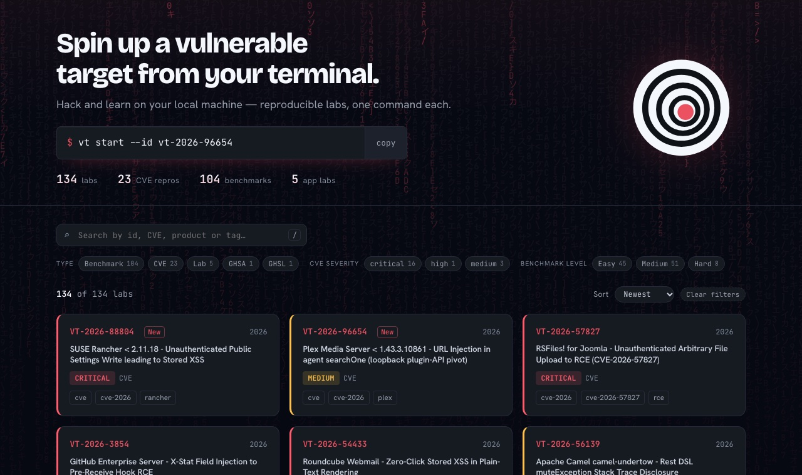
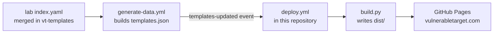

<p align="center">
  <a href="https://vulnerabletarget.com">
    <picture>
      <source media="(prefers-color-scheme: dark)" srcset="assets/brand/onion-cross-dark.svg">
      
    </picture>
  </a>
</p>

<h1 align="center">Vulnerable Target</h1>

<p align="center">
  <strong>Spin up a vulnerable target from your terminal.</strong><br>
  Reproducible, intentionally vulnerable labs (CVE reproductions, security benchmarks and app labs), one command each.
</p>

<p align="center">
  <a href="https://vulnerabletarget.com"></a>
  <a href="https://github.com/HappyHackingSpace/vt-site/actions/workflows/deploy.yml"></a>
  <a href="https://vulnerabletarget.com/feed.xml"></a>
  
</p>

<p align="center">
  <a href="https://vulnerabletarget.com">Browse the labs</a> ·
  <a href="https://github.com/HappyHackingSpace/vt">vt CLI</a> ·
  <a href="https://github.com/HappyHackingSpace/vt-templates">Lab templates</a> ·
  <a href="https://vulnerabletarget.com/feed.xml">RSS</a>
</p>

<p align="center">
  <a href="https://vulnerabletarget.com"></a>
</p>

---

## Run a lab

Install the [vt CLI](https://github.com/HappyHackingSpace/vt) (see its README), pick a lab on
[vulnerabletarget.com](https://vulnerabletarget.com) and start it with its ID:

```sh
vt start --id vt-2026-96654
```

Every lab page documents the vulnerability (summary, root cause, impact), the exploitation steps with the HTTP
requests involved, remediation and references.

> [!WARNING]
> These environments are intentionally vulnerable. Run them only on your own machine or on systems you have
> explicit written permission to test.

## What this repository is

The labs live in [vt-templates](https://github.com/HappyHackingSpace/vt-templates). This repository turns them
into the website: `build.py` is a dependency-free static site generator that writes everything to `dist/`.

| Output | What it is |
|---|---|
| `index.html` | The registry: search, filters, sort. The view is kept in the URL, so it can be shared. |
| `VT-YYYY-NNNNN/index.html` | One pre-rendered page per lab, with structured data (JSON-LD) for search engines. |
| `vt-…/`, `detail.html` | Redirects for the URLs the previous site published, so shared links keep working. |
| `404.html` | Offers a search for the missing ID and a prefilled request to add it as a lab. |
| `feed.xml` | RSS feed of the newest labs (linked from every page for feed readers). |
| `llms.txt`, `labs.json` | Machine-readable catalogue for AI answer engines. |
| `sitemap.xml`, `robots.txt` | The usual. |
| `og/<id>.png` | Per-lab share image, drawn by `og.py` when Pillow is installed (CI installs it). |

## How a new lab reaches the site

No manual step: merging a lab into vt-templates publishes it within minutes.



`generate-data.yml` also runs every night, so the site rebuilds at least once a day.

## Project structure

```
vt-site/
├── build.py              # site generator
├── og.py                 # per-lab share images (optional, needs Pillow)
├── assets/
│   ├── app.css           # design system (dark theme, tokens)
│   ├── brand/            # onion mark, icon set, share image
│   └── templates.json    # fallback data; CI replaces it with the latest from vt-templates
├── docs/
│   ├── SCHEMA.md         # template field reference
│   └── screenshot.jpg
└── .github/workflows/
    └── deploy.yml        # build + publish to GitHub Pages
```

## Run the site locally

```sh
python3 build.py
python3 -m http.server 8791 -d dist
```

Open <http://127.0.0.1:8791/>. With a `vt-templates` checkout next to this repository, `build.py` reads its
`templates.json`, so the preview shows whatever branch is checked out there. A new `index.yaml` appears only after
running `python .assets/generate_templates.py` in vt-templates.

## Contributing

- **Add or fix a lab:** open a pull request on [vt-templates](https://github.com/HappyHackingSpace/vt-templates).
- **Request a lab:** [open an issue](https://github.com/HappyHackingSpace/vt-templates/issues/new) with the CVE or
  advisory ID and the affected version.
- **The website itself:** pull requests here are welcome.

## License

MIT.

<p align="center"><sub>Made with 💀 by <a href="https://github.com/HappyHackingSpace">HappyHackingSpace</a></sub></p>
